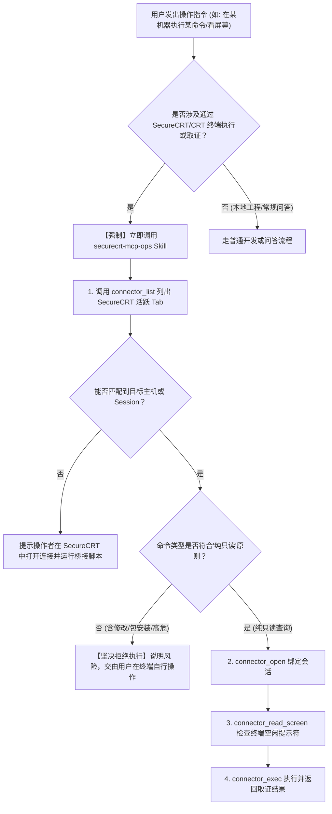
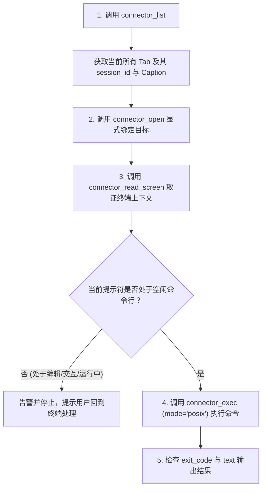

# SecureCRT MCP 运维与会话复用 Skill

## 1. 概述与核心能力

`securecrt-mcp` 是专为桌面终端设计的本机 Rust MCP Server。它通过 SecureCRT 原生加载的 JScript 桥接层与私有文件 IPC，让 AI 助手能够**直接沿用工程师已在 SecureCRT 中完成堡垒机认证、MFA 验证与登录的 SSH Tab**。

---

## 2. 触发与调用条件（何时必须调用本 Skill）

当操作者在对话中出现以下意图或关键词时，AI 助手**必须优先加载并执行本 Skill**，严禁使用未授权通道或盲目报错：

### A. 典型触发场景与指令样例

1. **直接提及终端工具名**：
   - *“测试下 securecrt mcp”*
   - *“通过 CRT / SecureCRT 执行一条命令”*
   - *“看下 SecureCRT 里打开了哪些会话”*
2. **指定目标主机/标签执行命令**：
   - *“在 `xxx` 执行 `ip add` / `df -h` / `uptime`”*（其中 `xxx` 为 SecureCRT 中的会话标签、主机别名或 IP）
   - *“帮我查一下生产 node-01 的内存和负载”*（在已由 SecureCRT 打开的前提下）
3. **终端状态取证与屏幕观察**：
   - *“看看当前终端屏幕在跑什么”*
   - *“读取一下 CRT 对应窗口的实时屏幕”*
   - *“确认下当前终端提示符空闲了没”*
4. **服务器只读巡检与排障取证**：
   - *“在服务器上巡检一下 Docker 容器状态”*
   - *“排查下某台机器磁盘占用过高的目录，只读取证”*
   - *“抓取某个服务的最近 100 行日志”*

### B. 前置意图判定与决策树



---

## 3. 工具与核心特性

### 核心特性

- **凭据零泄露**：不导出、不保存、不中转任何 SSH 密码、私钥或 Token；不发起新的独立 SSH 连接，完全沿用当前 Tab 的登录上下文与权限。
- **状态机与 POSIX 退出码**：通过 POSIX 评估信封与随机边界标记跟踪命令生命周期，返回真实的 `exit_code`、命令状态、执行耗时与分页输出。
- **屏幕上下文守卫**：支持读取终端实时屏幕与提示符（`screen_token`），执行命令前校验当前处于空闲命令行，执行中或未决状态绝不自动重试或盲目发送输入。

### 核心 MCP 工具清单（`connector_*`）

| 工具名称                  | 分组       | 核心说明                                                                                                              |
| :------------------------ | :--------- | :-------------------------------------------------------------------------------------------------------------------- |
| `connector_list`        | 会话发现   | 枚举 SecureCRT 当前已打开并连接的所有 Tab（返回各 Tab 的 `session_id`、`caption`、目标主机 IP、用户与支持能力）。 |
| `connector_open`        | 会话绑定   | 显式绑定选定的 SecureCRT 会话，生成当前 MCP 连接独占的附件句柄（`mode="exec"`）。                                   |
| `connector_read_screen` | 屏幕取证   | 读取当前终端屏幕可视文本、光标位置、行数/列数与最新的空闲提示符（`screen_token`）。                                 |
| `connector_exec`        | 单命令执行 | 在已绑定的会话中执行单条命令，支持 `mode="posix"` 并返回准确的退出码与命令输出。                                    |
| `connector_exec_batch`  | 批量命令   | 最多 20 条命令顺序执行，遇非零退出码或未知状态时自动停止后续条目。                                                    |
| `connector_read`        | 分页读取   | 针对超长命令输出（超过 64KB），按绝对游标（`cursor`）读取后续输出页，无需重复执行原命令。                           |
| `connector_interrupt`   | 显式中断   | 向正在执行的命令发送显式中断信号（Ctrl+C），保留中断结果记录。                                                        |
| `connector_close`       | 释放会话   | 释放本地附件绑定，断开 MCP 控制，保留 SecureCRT 原生 SSH 连接不中断。                                                 |

---

## 4. 环境配置与前置要求

> **项目开源地址与官方文档**：  
> MCP 源码仓库与具体安装文档请参考：[https://github.com/seaworld008/securecrt-mcp](https://github.com/seaworld008/securecrt-mcp)

### A. 服务端安装与前置部署
1. **下载与释放二进制**：
   - 从 [GitHub Releases](https://github.com/seaworld008/securecrt-mcp/releases/latest) 下载对应系统架构的包（如 Windows `x86_64-pc-windows-msvc.zip`）。
   - Windows 环境可直接运行包内 `install.cmd`（自动部署至用户私有目录并完成基础初始化），或运行 `initialize-only.cmd` 仅释放组件。
   - 默认应用目录为：`C:\Users\<用户名>\.securecrt-mcp\`
   - 核心文件清单：
     - `securecrt-mcp.exe`（MCP 核心服务二进制）
     - `securecrt-mcp-securecrt.js`（SecureCRT 专用 JScript 桥接脚本）
     - `securecrt-mcp-xshell.js`（Xshell 专用 JScript 桥接脚本，如需）

2. **加载 SecureCRT 桥接脚本**：
   - 打开 SecureCRT，连接目标服务器并进入命令行。
   - 菜单栏选择：`Script` (脚本) -> `Run...` (运行...)。
   - 选择脚本文件：`C:\Users\<用户名>\.securecrt-mcp\securecrt-mcp-securecrt.js`。
   - 弹窗提示“已连接 X 个会话”后，终端已进入可被 MCP 控制的状态。

3. **环境健康诊断（可选）**：
   - 在终端或 PowerShell 中执行诊断检查：
     ```powershell
     C:\Users\<用户名>\.securecrt-mcp\securecrt-mcp.exe doctor --offline
     C:\Users\<用户名>\.securecrt-mcp\securecrt-mcp.exe sessions
     ```

### B. VS Code / Codex / Claude MCP 配置

在工作区或全局的 `.mcp.json` 中配置：

```json
{
  "servers": {
    "securecrt": {
      "type": "stdio",
      "command": "C:\\Users\\<用户名>\\.securecrt-mcp\\securecrt-mcp.exe",
      "args": ["serve"]
    }
  }
}
```

---

## 5. 标准操作工作流（三步走准则）

所有针对 SecureCRT 的操作必须严格遵循**“发现 -> 绑定/验屏 -> 执行”**流程，严禁凭空臆测 `session_id`：



### 步骤详解

1. **第一步：发现会话 (`connector_list`)**

   - 列出所有活跃的 SecureCRT Tab。
   - 根据用户指定的服务器名称（如 Caption“app-node-01”或目标 IP `192.168.1.100`）定位具体的会话项。
   - 记录会话对象中的 `id` 或 `session_id`。
2. **第二步：显式绑定 (`connector_open`)**

   - 请求参数：
     ```json
     {
       "backend": "securecrt",
       "target": "3c91a420-1b2c-4ef1-9876-123456789abc/session/1",
       "mode": "exec"
     }
     ```
   - 获取绑定的 `session_id`（通常形如 `securecrt/<instance>/attachment/<id>`）。
3. **第三步：确认终端状态 (`connector_read_screen`)**

   - 检查 `current_line` 是否为空闲 Shell 提示符（如 `[user@host ~]#` 或 `user@host:~$ `）。
   - 若终端正在运行长时间任务、处于 `vi`、`top`、`less` 或 `docker logs -f` 交互界面，**严禁发送命令**。
4. **第四步：执行命令 (`connector_exec`)**

   - 请求参数：
     ```json
     {
       "session_id": "securecrt/3c91a420-1b2c-4ef1-9876-123456789abc/attachment/1",
       "command": "uname -a",
       "mode": "posix",
       "timeout_ms": 15000
     }
     ```
   - 检查返回结果的 `state: "completed"` 与 `exit_code: 0`。

---

## 6. 运维命令编写准则

1. **严格纯只读原则与非交互式约束**：
   - **仅限只读查询**：AI 仅能代行纯只读查询与诊断类命令（如系统指标、网络状态、进程列表、日志检索、配置查看等），**严禁对系统进行任何修改或写操作**。
   - **拒绝任何软件包安装/升级/卸载**：拒绝执行 `yum install/update/remove`、`apt-get install/upgrade/purge`、`rpm -i/-e`、`dpkg -i/-r`、`pip install`、`npm install` 等系统或应用包管理变更命令。遇到安装或修改需求，仅提供建议命令，交由操作者自行在终端执行。
   - **非交互式约束**：严禁执行会挂起或进入交互式界面的命令。
   - `top` 必须使用批处理只读模式：`top -b -n 1`。
   - `systemctl status` 等命令必须显式关闭分页：`systemctl status <service> --no-pager`。
   - 严禁调用交互式文本编辑工具（如 `vi`、`vim`、`nano`）。

2. **单行命令原子性与脚本前置审计**：
   - 多条关联排障命令使用 `&&` 或 `;` 连接，如：`cd /opt/app && ls -l`。
   - **脚本执行前必须先只读查看与安全审计**：操作者要求执行任何现有脚本（如 `.sh`、`.py` 等）前，**AI 必须先以只读方式查看脚本完整内容**（例如使用 `cat /path/to/script.sh` 取证）：
     - 逐行审查脚本中是否包含系统修改、文件清理、服务启停、软件包安装、环境覆写或数据库变动等操作。
     - **仅在确认脚本为纯只读、绝对无系统修改风险时**，方可由 AI 执行。
     - **若脚本存在任何系统修改或高危操作**，AI 必须**直接拒绝代为执行**，明确指出风险行及潜在影响，交由操作者自行在终端确认并手动执行。

3. **分页与大输出处理**：
   - 若执行日志过滤或大量数据查询，建议在命令中添加 `head -n 100` 或 `grep` 精确过滤。
   - 若返回结果带有 `next_cursor`，使用 `connector_read` 读取下一页，**切勿重复执行原命令**。

---

## 7. 安全红线与运维规范（必须严格遵守）

1. **绝对只读铁律与系统修改拒绝机制**：
   - 严格遵循团队铁律：**“排障仅限只读取证，严禁代行任何系统修改，变更命令交由操作者手动执行”**。
   - **只读查询放行**：`ip add`、`uptime`、`df -h`、`free -m`、`ps aux`、`netstat/ss`、`docker ps`、`kubectl get/describe`、`cat/grep` 等纯读命令可直接执行。
   - **系统修改与高危破坏性命令一律拒绝自动执行**：
     - **拒绝变更与安装**：拒绝 `yum/apt` 安装更新、拒绝 `systemctl start/stop/restart/reload`、拒绝文件创建修改重命名（如 `echo >`、`sed -i`、`mv`、`cp` 覆盖等）。
     - **拒绝高危破坏操作**：严禁代行 `rm`、`reboot`、`shutdown`、`init 0/6`、`dd`、`mkfs`、`fdisk`、`iptables -F`、`kill -9`、数据库变更删除（`drop/truncate/delete/update`）等任何破坏性或不可逆操作。
     - 遇到上述任何需求，AI 必须**坚决拒绝代为执行**，给出命令语法与操作风险说明，交由操作者自己在终端手动确认并执行。
2. **绝不自动重试未知结果**：
   - 若因网络抖动或超时导致 `connector_exec` 返回 `rejected`、`timeout` 或 `unknown`，**严禁自动重发原命令**。必须先调用 `connector_read_screen` 观察终端屏幕真实状态。
3. **敏感信息脱敏**：
   - 执行排障时，若屏幕或命令输出中出现明文密码、私钥、Token 等敏感数据，报告中必须进行脱敏打码。

---

## 8. 调用示例

### 示例 1：巡检目标主机网络与磁盘

```text
1. 查找会话：
   connector_list()
   -> 匹配到目标服务器 (192.168.1.100)，id: "3c91a420-1b2c-4ef1-9876-123456789abc/session/1"

2. 绑定会话：
   connector_open(backend="securecrt", target="3c91a420-1b2c-4ef1-9876-123456789abc/session/1", mode="exec")
   -> 获得 attachment session_id: "securecrt/.../attachment/1"

3. 检查屏幕状态：
   connector_read_screen(session_id="securecrt/.../attachment/1")
   -> 确认处于空闲提示符 "[user@app-node-01 ~]# "

4. 执行巡检命令：
   connector_exec(
     session_id="securecrt/.../attachment/1",
     command="df -h && free -m",
     mode="posix",
     timeout_ms=10000
   )
   -> 解析输出并在对话中总结磁盘与内存健康状态
```
